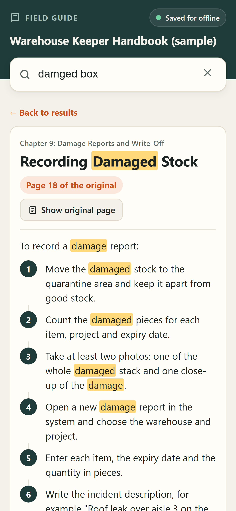

# offline-field-guide

Give it a long PDF manual and it builds a searchable guide that keeps working on a phone with no connection.

**Live demo:** https://tonihaddad.github.io/offline-field-guide/

<table>
<tr>
<td></td>
<td></td>
<td></td>
</tr>
<tr>
<td>"turn of gass": typos are fine</td>
<td>Opened section, terms highlighted, source page shown</td>
<td>Same search with the network cut</td>
</tr>
</table>

These are real screenshots of the guide built from the 268-page FEMA CERT
Basic Training Participant Manual, at phone width. More in [`docs/`](docs/)
(dark mode, the original-page view, the contents list).

## The need

A field officer needs one instruction from a 200-page manual: how to shut
off the gas, how many drops of bleach per gallon, how to apply a tourniquet.
The manual is a PDF that is slow to open on a phone and has no useful search,
and the connection is poor or gone. This tool turns the PDF into a small web
app that is saved on the phone the first time it is opened, then answers
short, misspelled questions in milliseconds with no network at all.

## Try it

Python 3.11+ and nothing else (Node only for the benchmark).

```
python -m venv .venv
.venv/Scripts/activate            # source .venv/bin/activate on Linux/macOS
pip install -e .
fieldguide build manuals/cert-basic-training-participant-manual.pdf --out site && fieldguide serve site
```

Real output (the build takes about 1.5 minutes on a laptop, most of it table detection):

```
Read 268 pages from cert-basic-training-participant-manual.pdf
Sections:        342
Index terms:     3,612
sections.json:   412 KB
index.json:      177 KB
Total download:  637 KB in 10 files
Wrote site
Serving site at http://localhost:8101/
```

Open http://localhost:8101/ once, then turn the network off. On a phone,
"Add to home screen" installs it as an app. Add `--page-images` to include a
low-resolution image of every page behind a "Show original page" button.

## How it works

```
manual.pdf
   |  PyMuPDF: text lines with font size/weight and position, tables, outline
   v
extract.py    drop running headers, footers and page numbers
   |          (same text in the top/bottom band on 3+ pages, or "Page 7-20")
   v
structure.py  headings from the PDF outline + font size/weight
   |          one section per heading; paragraphs, numbered steps, bullets
   |          and tables join across page breaks and stay in their section
   v
index.py      BM25 index built at build time (title words weighted x3)
   v
site/         index.html, app.js, search.js, sw.js, manifest, data/*.json
              [pages/p1.jpg ... with --page-images]
```

| Part | What it does |
|---|---|
| Page breaks | Headers and footers are removed first, so the last line of page N meets the first line of page N+1. A step or paragraph that has not finished its sentence continues; "Step 6" after "Step 5" extends the same procedure. In the CERT manual the tourniquet steps (pages 102-103) and the 9-step size-up (pages 64-65) cross a page break and come out as one list. |
| Tables | Found with PyMuPDF's table finder; their cells are kept out of the text flow, so a bold header row is never mistaken for a heading. A table at the top of the next page stays with its section, and a table split over two pages is merged with its repeated header row dropped. |
| Search | `search.js`, about 180 lines of plain JavaScript, no dependencies. BM25 over the sections; each query word also matches words that start with it (0.8 weight) and, when nothing matches, words one typo away (two for long words). A section that matches every query word ranks higher. |
| Offline | The service worker caches every file on first load (the list and a content hash are written in at build time) and serves from the cache afterwards. The status pill checks the cache and the server, so it says "Offline, saved copy" when it really is. |
| Same tokenizer twice | Python builds the index and JavaScript queries it, so both tokenizers must agree. A test runs both on the same strings. |

## Results

`node bench/run_bench.js site` runs the shipped `search.js` under Node on 26
lookups I wrote after reading the manual ([`bench/questions.json`](bench/questions.json)),
each with the PDF page(s) that hold the answer. A hit means the opened section
contains an answer page and is at most 6 pages long. Output of the last run:

```
Questions:            26
Top-1 accuracy:       25/26 (96%)
Top-3 accuracy:       26/26 (100%)
Sections:             342 from 268 pages
Index size:           177 KB (51 KB gzipped)
Download, no images:  641 KB in 10 files (189 KB gzipped)
Download, with images: 7.16 MB in 278 files (page images 6.53 MB)
Search time:          median 0.02 ms, p95 0.78 ms (780 runs, Node v24.19.0)
```

Search time varies between runs (p95 was between 0.8 and 3.3 ms across my runs); queries
with a typo are the slow ones because they scan the vocabulary.

Offline proof, `python scripts/offline_check.py` (Playwright, headless Chromium,
phone viewport): it loads the site, waits for the service worker, cuts the
network, reloads, searches with typos and opens a result.

```
PASS  service worker active, 278 files cached
PASS  page reloads with the network off
PASS  status shows offline ('Offline · saved copy')
PASS  a request outside the cache fails (really offline)
PASS  search 'shut of gass' offline: 20 results, top: 'Natural Gas Shutoff'
PASS  opened section 'Natural Gas Shutoff' with 24 highlighted terms
PASS  shows the source page ('Page 177 of the original')
OFFLINE CHECK PASSED
```

Tests: `pytest` runs 30 tests. The extraction tests build small PDFs with
PyMuPDF (a procedure whose step 4 wraps onto the next page, running headers
and "Page N" footers, a table of exceptions at the top of a page with a bold
header row and a "Table 3" caption, a table split over two pages, a bullet
glyph drawn apart from its text, an outline-only heading) and the search
tests run the real `search.js` under Node.

## Where it fails

- **Questions the manual does not answer still get confident results.**
  "drop cover hold" (earthquake advice the CERT manual does not contain)
  returns "Guidelines for Treating Heat Burns" first, because "drop" matches
  "drops" and "dropper". There is no "not in this manual" signal yet.
- **Prefix matching adds noise for short words.** "radio" ranks "Nuclear
  Attack" first: the prefix expands to "radioactive", which that section uses
  many times, while the manual's few mentions of a radio sit in long kit lists.
- **Exercises outrank instructions.** "recovery position" opens "Exercise 3.2:
  Recovery Position" first; the section that explains the position is second.
- **The benchmark is partly tuned.** I wrote the questions knowing the section
  titles, so many match a title. The first run scored 24/26: "extinguisher
  pass" missed because "P.A.S.S." was split into single letters. I fixed the
  tokenizer after seeing that miss, so that question is no longer a blind test.
- **Layout limits.** Forms and diagrams that are images (the CERT forms on
  pages 83-91) have no text to index; scanned PDFs would need OCR, which this
  does not do. Unit cover pages lose most of their text. "Page N" is the PDF
  page number, not the manual's printed "Page 7-20" label.

## What I would add next

- A confidence floor that says "not covered in this manual" instead of weak matches.
- Read the printed page labels so "page 7-20" matches the paper copy.
- An optional on-device or server LLM step that answers in one sentence and
  cites the section; the retrieval here would be its source of truth.

## Publishing a live demo

`.github/workflows/pages.yml` builds the guide with page images and deploys it
to GitHub Pages. It runs only when started by hand (Actions, "Publish demo to
GitHub Pages", Run workflow) after the repo is public and Pages is set to
"GitHub Actions". That is how the live link is enabled; it is not on yet.

## The sample manual and its licence

`manuals/cert-basic-training-participant-manual.pdf` is the **CERT Basic
Training Participant Manual (2019)**, downloaded from
https://www.ready.gov/sites/default/files/2019.CERT_.Basic_.PM_FINAL_508c.pdf
(5.3 MB, SHA-256 `ca297bbc329c322ccbcb252fae7a1c89fd95f93dbf72b78b165b53cafa664026`).
It is a U.S. federal government work: the PDF's author field is "FEMA", it is
published on ready.gov (a FEMA site), and its introduction says the National
CERT Program Office produced the 2019 update. Works of the U.S. federal
government are not subject to copyright in the United States (17 U.S.C. 105),
so it is in the public domain there. I found no third-party copyright or
permission notices in the document.

## Licence

Code: MIT, see [LICENSE](LICENSE). Sample manual: U.S. public domain, as above.
