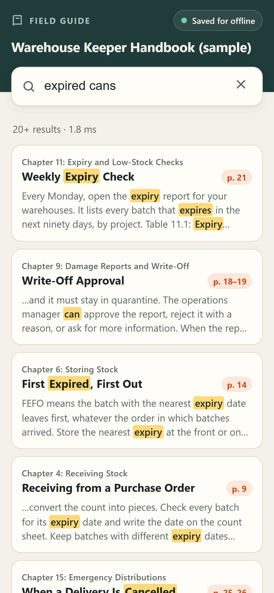
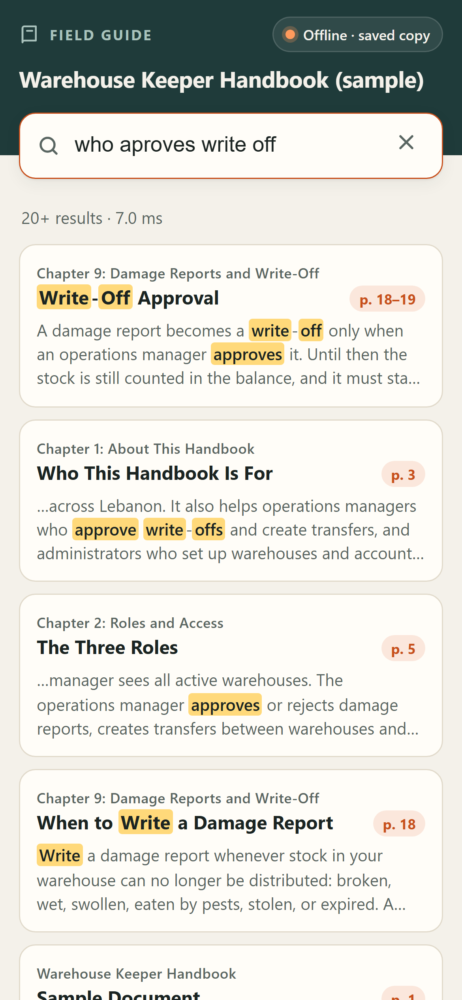

# offline-field-guide

Give it a long PDF manual and it builds a searchable guide that keeps working on a phone with no connection.

**Live demo:** https://tonihaddad.github.io/offline-field-guide/ (the sample handbook; the FEMA manual is one tap away at [`/cert/`](https://tonihaddad.github.io/offline-field-guide/cert/))

<table>
<tr>
<td></td>
<td></td>
<td></td>
</tr>
<tr>
<td>"expired cans"</td>
<td>"damged box": the procedure, terms highlighted, source page shown</td>
<td>"who aproves write off" with the network cut</td>
</tr>
</table>

Real phone-width screenshots of the guide built from the sample Warehouse
Keeper Handbook. More in [`docs/`](docs/): the contents list, the original-page
view, dark mode, and the FEMA CERT manual guide.

## The need

A humanitarian organization in Lebanon runs about forty warehouses. Its
warehouse keepers receive, store and dispatch relief stock, often with basic
computer skills, a phone, and power and internet that come and go. The rules
they must follow (goods received notes, waybills, FEFO, boxes and pieces,
damage reports that need approval) sit in a long PDF that is slow to open on a
phone and has no useful search. This tool turns such a PDF into a small web
app that is saved on the phone the first time it is opened, then answers
short, misspelled questions in milliseconds with no network at all.

## The two demo manuals

| Manual | Pages | Why it is here |
|---|---|---|
| **Warehouse Keeper Handbook (sample)**, `manuals/warehouse-keeper-handbook.pdf` | 42 | The main demo, close to the real work. **I wrote it for this demo; it is not an official document of any organization.** All names, codes and figures are invented. `handbook/make_handbook.py` builds it from `handbook/handbook.txt`. |
| **FEMA CERT Basic Training Participant Manual (2019)**, `manuals/cert-basic-training-participant-manual.pdf` | 268 | Proof that the pipeline works on a real PDF it was not written for. |

The handbook covers receiving under a goods received note, in-kind donations,
dispatch on a waybill, FEFO, boxes and pieces, transfers, damage reports and
write-off approval, stock counts, expiry and low-stock checks, the purchase
order sheet, working when the connection drops, roles, emergency
distributions, and a short French section. Its layout deliberately has what
real manuals have: a cover, a contents page, running headers and "Page N of
42" footers, a numbered procedure that runs over a page break, exception tables
that start at the top of a page, and tables continued over pages with the
header row repeated. The generator reports where these happen and the tests
check that the extractor handles each one.

## Try it

Python 3.11+ (Node only for the benchmark).

```
python -m venv .venv
.venv/Scripts/activate            # source .venv/bin/activate on Linux/macOS
pip install -e .
fieldguide build manuals/warehouse-keeper-handbook.pdf --out site --related "FEMA CERT manual=cert/" && fieldguide build manuals/cert-basic-training-participant-manual.pdf --out site/cert --related "Handbook=../" && fieldguide serve site
```

Real output (the CERT build takes about 1.5 minutes, mostly table detection):

```
Read 42 pages from warehouse-keeper-handbook.pdf
Sections:        64
Index terms:     1,021
sections.json:   58 KB
index.json:      27 KB
Total download:  133 KB in 10 files
Wrote site
Read 268 pages from cert-basic-training-participant-manual.pdf
Sections:        342
Index terms:     3,612
sections.json:   412 KB
index.json:      177 KB
Total download:  638 KB in 10 files
Wrote site/cert
Serving site at http://localhost:8101/
```

Open http://localhost:8101/ and the CERT guide once each, then turn the
network off. "Switch guide" on the home screen moves between them offline. On
a phone, "Add to home screen" installs it. Add `--page-images` to include a
low-resolution image of every page behind a "Show original page" button.
`python handbook/make_handbook.py` regenerates the handbook PDF.

## How it works

```
manual.pdf
   |  PyMuPDF: text lines with font size/weight and position, tables, outline
   v
extract.py    drop running headers, footers and page numbers
   |          (same text in the top/bottom band on 3+ pages, or "Page 7 of 42")
   v
structure.py  headings from the PDF outline + font size/weight
   |          one section per heading; paragraphs, numbered steps, bullets
   |          and tables join across page breaks and stay in their section
   v
index.py      BM25 index built at build time (title words weighted x3)
   v
site/         index.html, app.js, search.js, sw.js, manifest, data/*.json
site/cert/    a second guide, with its own service worker and cache
```

| Part | What it does |
|---|---|
| Page breaks | Headers and footers are removed first, so the last line of page N meets the first line of page N+1. A step or paragraph that has not finished its sentence continues; step 6 after step 5 extends the same procedure. |
| Tables | Found with PyMuPDF's table finder; their cells are kept out of the text flow, so a bold header row is never mistaken for a heading. A table at the top of the next page stays with its section, and a table split over pages is merged with its repeated header row dropped. |
| Search | `search.js`, about 180 lines of plain JavaScript, no dependencies. BM25 over the sections; each query word also matches words that start with it and, when nothing matches, words one typo away (two for long words). Accents are ignored, so "reception" finds "réception". |
| Offline | Each guide's service worker caches every file of that guide on first load and serves from the cache afterwards. Caches are named per guide, so the two guides on one site never delete each other's files. |

## Results

`node bench/run_bench.js <site> <questions>` runs the shipped `search.js`
under Node. A hit means the opened section contains a page that holds the
answer and is at most 6 pages long.

| | Handbook (new) | FEMA CERT manual |
|---|---|---|
| Questions | 23 (20 English, 3 French) | 26 |
| Top-1 accuracy | **17/23 (74%)** | 25/26 (96%), unchanged |
| Top-3 accuracy | **20/23 (87%)** | 26/26 (100%), unchanged |
| Index size | 27 KB (8 KB gzipped) | 177 KB (51 KB gzipped) |
| Download, no page images | 134 KB, 10 files | 643 KB, 10 files |
| Download, with page images | 1.04 MB, 52 files | 7.16 MB, 278 files |
| Search time, median / p95 | 0.02 / 0.53 ms | 0.04 / 2.15 ms |

How the handbook questions were made: I wrote both the handbook and its
questions, so this is not an independent test. I wrote the 23 questions the
way a keeper might type them (three misspelled, three in French) after writing
the handbook and **before running any search on it**, each with a phrase from
the handbook that answers it; `bench/resolve_pages.py` turns the phrases into
page numbers. I did not change any rule or label after seeing the results. The
CERT questions and engine are the same as in the first version, so its numbers
did not change.

Offline proof, `python scripts/offline_check.py` (Playwright, headless
Chromium, phone viewport): it opens both guides online, cuts the network,
reloads the handbook, searches and opens a result, then switches to the CERT
guide with the network still off and does the same.

```
PASS  /: service worker active, caches hold [52] files
PASS  /cert/: service worker active, caches hold [52, 278] files
PASS  / opens with the network off: 'Warehouse Keeper Handbook (sample)'
PASS  status shows offline ('Offline · saved copy')
PASS  a request outside the cache fails (really offline)
PASS  search 'damged box' offline: 20 results, top: 'Terms Used in This Handbook'
PASS  opened section 'Terms Used in This Handbook' with 6 highlighted terms
PASS  shows the source page ('Page 33 of the original')
PASS  /cert/ opens with the network off: 'CERT Basic Training Participant Manual'
PASS  status shows offline ('Offline · saved copy')
PASS  a request outside the cache fails (really offline)
PASS  search 'shut of gass' offline: 20 results, top: 'Natural Gas Shutoff'
PASS  opened section 'Natural Gas Shutoff' with 24 highlighted terms
PASS  shows the source page ('Page 177 of the original')
OFFLINE CHECK PASSED
```

Tests: `pytest` runs 37 tests. The handbook tests regenerate the PDF and check
that each procedure the layout put over a page break comes out as one list,
that the exceptions table at the top of page 11 stays in "Problems at
Receipt", that the 77-row item table split over pages 34 to 36 is one table with
one header row, that no header or footer text leaks into sections, and that
the committed question labels still match the PDF. Other tests build small
PDFs for the same hard cases and run the real `search.js` under Node.

## Where it fails

- **Glossary and appendices outrank the explanation.** "damged box" opens the
  glossary first (the procedure is third); "unlock warehouse" opens the
  warehouse list, where "Unlocked" appears 26 times; "short expiry donation"
  opens a paper form.
- **Different words for the same thing.** "less pieces than order" misses the
  row "Fewer pieces than the purchase order": there is no synonym handling.
- **Strict labels.** "recieve without po" and "balance negative" are counted
  as misses, but their top results ("If a Delivery Arrives Without an Accepted
  Purchase Order", "If the System Refuses a Paper Document") also answer the
  question. I kept the labels I wrote before running the test.
- **No Arabic.** The tokenizer only keeps Latin letters and digits, so Arabic
  text is not indexed and Arabic queries find nothing. The handbook has no
  Arabic section because the PDF fonts used here cannot shape Arabic. French
  works through accent folding, without French stemming.
- **No "not in this manual" signal.** On the CERT manual, "drop cover hold"
  (advice it does not contain) returns heat-burn guidance first because "drop"
  matches "drops". "radio" ranks "Nuclear Attack" first because the prefix
  expands to "radioactive".
- **Layout limits.** Forms and diagrams that are images have no text to index;
  scanned PDFs would need OCR, which this does not do. "Page N" is the PDF page
  number, not a printed label. Each guide must be opened once online before it
  works offline.

## What I would add next

- A confidence floor that says "not covered in this manual", and a small synonym list per manual.
- Arabic tokenization and an Arabic version of the handbook.
- An optional LLM step that answers in one sentence and cites the section; the retrieval here would be its source of truth.

## Publishing the live demo

`.github/workflows/pages.yml` builds both guides with page images and deploys
them to GitHub Pages when run by hand (`gh workflow run pages.yml`).

## Licences

Code: MIT, see [LICENSE](LICENSE). The sample handbook is part of this repo
and under the same licence; it is invented and not an official document of any
organization.

The CERT manual was downloaded from
https://www.ready.gov/sites/default/files/2019.CERT_.Basic_.PM_FINAL_508c.pdf
(5.3 MB, SHA-256 `ca297bbc329c322ccbcb252fae7a1c89fd95f93dbf72b78b165b53cafa664026`).
It is a U.S. federal government work: the PDF's author field is "FEMA", it is
published on ready.gov (a FEMA site), and its introduction says the National
CERT Program Office produced the 2019 update. Works of the U.S. federal
government are not subject to copyright in the United States (17 U.S.C. 105).
I found no third-party copyright or permission notices in it.
